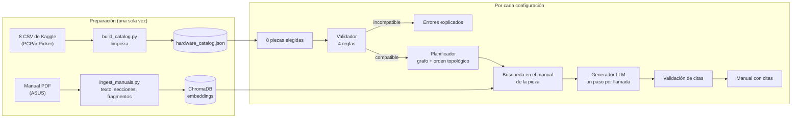
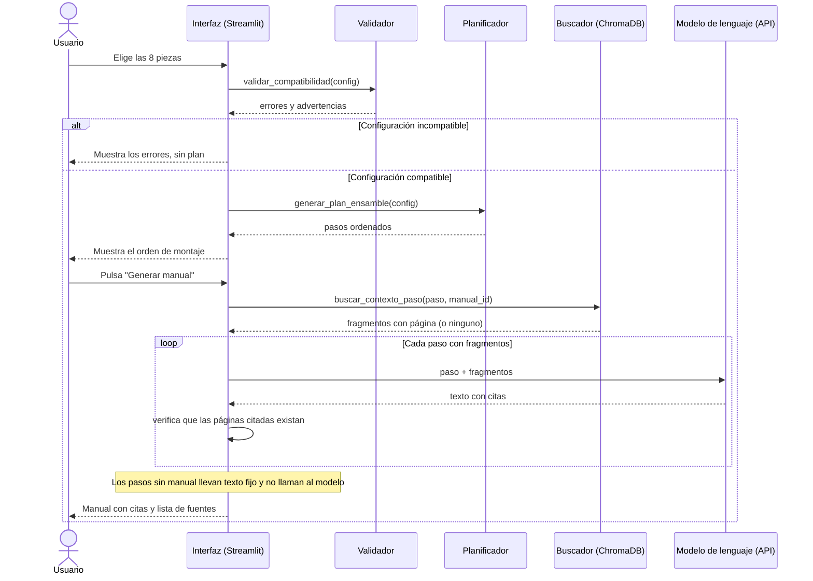

# PC-Assembly-RAG

**Asistente de ensamble de computadores: compatibilidad por reglas, orden de montaje por grafos y manual personalizado con RAG sobre manuales de fabricantes.**

Proyecto final de **Inteligencia Artificial (SI3003)** · Universidad EAFIT · 2026-2

**Autores:** Juan José Díaz Rodríguez · Alejandro Jaramillo · Felipe Martinez · Jhesid Steven Suarez 
**Fecha:** 13-11-2026

---

## 1. Introducción

Quien arma un computador tiene ocho piezas independientes (procesador, placa madre, tarjeta gráfica, memoria RAM, almacenamiento, refrigeración, fuente y gabinete) y ningún manual que las conozca a todas: cada una trae el suyo. De ahí salen tres problemas: las incompatibilidades (socket, tipo de RAM, tamaño, potencia) se descubren tarde; el orden de montaje importa y equivocarse obliga a desarmar; y los detalles de la placa concreta (en qué ranuras va la RAM, a qué conectores va el panel frontal) están enterrados en un manual de decenas de páginas.

El proyecto combina técnicas clásicas (reglas y un grafo de precedencias con orden topológico) con IA moderna (recuperación semántica sobre el manual oficial y un modelo de lenguaje). La idea central es que **el modelo de lenguaje solo redacta**: lo que se puede calcular lo calcula el código, y cada dato tomado de un manual lleva una cita de página que se verifica contra el fragmento recuperado.

## 2. Objetivo

**General:** generar, para una configuración de ocho piezas, un manual de ensamble personalizado cuyos datos técnicos provengan de los manuales oficiales y estén citados con su página.

**Específicos:**
1. Detectar el 100 % de las incompatibilidades en 20 configuraciones de prueba (10 compatibles y 10 incompatibles) y producir, en todos los casos, un orden de montaje que respete las precedencias físicas.
2. Recuperar el fragmento correcto del manual entre los 3 primeros resultados (Recall@3) en al menos el 90 % de las consultas de prueba.
3. Lograr que el 100 % de las citas del manual generado correspondan a fragmentos recuperados y que no aparezcan pines, ranuras ni cables inventados (0 alucinaciones).

## 3. Datos

| Fuente | Forma de obtención | Tamaño y formato | Variables principales |
|---|---|---|---|
| **Catálogo de hardware** | CSV de especificaciones derivados de PCPartPicker, descargados de Kaggle | 8 CSV, 14.031 filas, 3,8 MB → `hardware_catalog.json` con 14.030 piezas, 2,4 MB | Ver tabla siguiente |
| **Manual de la placa** | PDF oficial de ASUS (TUF GAMING B650-PLUS WIFI) | 1 PDF, 43 páginas, 3,2 MB → 109 fragmentos | `chunk_id`, `manual_id`, `pagina`, `pagina_etiqueta`, `seccion`, `texto` |

| Tipo de pieza | Piezas | Variables que usa el sistema |
|---|---|---|
| Procesador | 458 | socket, frecuencia, núcleos, hilos, consumo (W) |
| Placa madre | 2.421 | socket, tamaño, tipo de RAM y su confianza |
| Tarjeta gráfica | 2.515 | memoria de video, resolución, consumo (W) |
| Memoria RAM | 1.707 | tipo (DDR3/4/5), capacidad |
| Almacenamiento | 2.172 | tipo (NVMe/SATA/HDD), capacidad |
| Refrigeración | 872 | tipo (aire/líquido) |
| Fuente de poder | 2.314 | potencia (W), tamaño (ATX/SFX) |
| Gabinete | 1.571 | tamaño (ATX/MicroATX/ITX) |

**Preprocesamiento** (`scripts/build_catalog.py` y `scripts/ingest_manuals.py`):
- El tamaño de las placas se deduce del nombre, porque el CSV marca como ATX a casi todas las Micro ATX.
- El CSV no trae el tipo de RAM de las placas: se deduce del nombre (DDR3/4/5), luego de una tabla de correcciones hecha por el equipo para LGA 1700 y, por último, del socket. Cada placa guarda su nivel de confianza (1.708 alta, 713 media).
- Se excluye 1 registro con socket erróneo.
- El manual se lee con `pypdf` (el PDF está cifrado con AES), se divide por secciones y en fragmentos de ~400 palabras con 50 de solapamiento, y cada fragmento conserva la página del PDF y la numeración impresa (por ejemplo, `1-8`).

**Limitaciones y sesgos:**
- El catálogo no trae el largo de la tarjeta gráfica ni el espacio del gabinete, así que no se valida si la GPU cabe físicamente, ni la compatibilidad socket–disipador.
- El tipo de RAM de 713 placas (29 %) es una deducción de confianza media.
- Hay un solo manual (la placa ASUS): con la configuración de ejemplo, 9 de los 15 pasos tienen manual y los otros 6 dicen «Sin manual disponible para esta pieza».
- Los diagramas de pines de los manuales son imágenes: el texto describe cada conector pero no indica qué pin es cuál, y el sistema no lo inventa.
- PCPartPicker es un sitio estadounidense: el catálogo refleja ese mercado.

**Licencia y uso de los datos:**
- **Especificaciones (CSV):** dataset *PC Parts* de warcoder en Kaggle ([enlace](https://www.kaggle.com/datasets/warcoder/pc-parts)). Licencia declarada: *Unknown* (sin licencia explícita). Los datos provienen de PCPartPicker. Se usan solo con fines académicos y no se redistribuyen con fines comerciales.
- **Manuales (PDF):** documentos públicos de ASUS, usados con fines académicos. Los derechos son del fabricante; se incluye el manual de la placa como muestra.

## 4. Metodología

**Figura 1. Flujo metodológico: de los datos al manual con citas.**



**Etapas y decisiones principales:**

| Etapa | Qué hace | Por qué así |
|---|---|---|
| Compatibilidad | 4 reglas: socket, tipo de RAM, tamaño del gabinete y potencia (consumo de CPU + GPU + 75 W, más 150 W de margen) | Son reglas verificables; un modelo de lenguaje no debe decidirlas |
| Planificación | Grafo acíclico de 15 tareas (`networkx`) que se adapta al almacenamiento (NVMe o SATA/HDD) y a la refrigeración (aire o líquida); el orden sale de la ordenación topológica | El orden físico es un problema de precedencias, no de redacción |
| Recuperación | Fragmentos de ~400 palabras, embeddings `all-MiniLM-L6-v2` (locales y gratuitos), ChromaDB con distancia coseno, `top_k = 2` | No requiere API ni costo. Las consultas van en inglés porque el modelo y los manuales lo están |
| Consulta | Se busca solo en el manual de la pieza (`manual_id`) y la consulta no lleva los nombres de las piezas | Medido en una consulta: el fragmento correcto pasó de la posición 7 a la 1 |
| Generación | Una llamada por paso a `nvidia/nemotron-3-ultra-550b-a55b` (API compatible con OpenAI), temperatura 0,2. Los pasos sin manual no llaman al modelo | Llamadas pequeñas y verificables; el modelo no puede inventar pines donde no hay manual |
| Verificación | Cada página citada debe existir entre los fragmentos del paso; un reintento y, si falla, texto seguro con la descripción base | Apoya directamente la meta de 0 alucinaciones |

**Métricas, metas y línea base** (se usan tal cual en la sección 6):

| Módulo | Métrica | Meta | Línea base |
|---|---|---|---|
| Compatibilidad | Exactitud en 20 configuraciones | 100 % | Sin validador (todo «compatible»): 50 % |
| Planificador | Órdenes que respetan las precedencias | 100 % | Orden fijo del grafo base en configuraciones con SATA o refrigeración líquida |
| Recuperación | Recall@3 | ≥ 90 % | Consulta con nombres de pieza; búsqueda por palabras clave |
| Generador | Citas válidas / pines, ranuras o cables inventados | 100 % / 0 | El mismo modelo sin fragmentos del manual |

## 5. Diagrama de interacción (UML)

**Figura 2. Secuencia de una consulta en producción.**



## 6. Resultados

Cada fila usa las mismas métricas y datos de la sección 4.

| Módulo | Métrica | Meta | Línea base | Resultado |
|---|---|---|---|---|
| Compatibilidad | Exactitud en 20 configuraciones (`tests/test_compatibilidad.py`) | 100 % | 50 % | **20/20 (100 %)** |
| Planificador | Órdenes que respetan las precedencias (`tests/test_planificador.py`) | 100 % | No medida | **31/31 pruebas pasan** (precedencias y aciclicidad) |
| Recuperación | Recall@3 por página, 10 preguntas (`tests/test_rag.py`) | ≥ 90 % | Palabras clave: 100 % por página, 80 % por contenido | **100 % por página, 90 % por contenido** |
| Generador | Citas inválidas / pines, ranuras o cables inventados en pasos sin manual | 0 / 0 | No medida | **0 / 0** en 158 pasos |

**Generador: evaluación con el modelo real** (`scripts/evaluar_generador.py`, 10 configuraciones compatibles, `nvidia/nemotron-3-ultra-550b-a55b`, temperatura 0,2, una corrida por configuración, 2026-11-12):

| Medida | Resultado |
|---|---|
| Pasos evaluados | 158 (47 con manual, 111 sin manual) |
| Pasos con manual con cita válida | 74 % |
| Pasos con manual que terminaron en texto seguro | 26 % (por configuración, de 11 % a 60 %) |
| Pasos con el texto cortado a mitad de frase | 7 de 47 |
| Líneas del modelo sin cita | 23 de 115 |
| Líneas con datos técnicos fuera del fragmento citado | 20 |
| Líneas con datos técnicos fuera de todo lo que recibió el modelo | 0 |
| Reintentos por citas inválidas | 30 |

**Análisis:**
- **Qué funcionó.** El validador y el planificador cumplen sus metas y son deterministas. El buscador encuentra la página correcta en el top 3 en las 10 preguntas. En los 111 pasos sin manual el modelo no se llama y no apareció ningún pin, ranura ni cable inventado. Ninguna página citada es inexistente.
- **Qué no.** La meta de 0 citas inválidas se cumple en parte por construcción: la verificación descarta las respuestas con citas inventadas. La cifra que mide al modelo es que 1 de cada 4 pasos con manual (26 %) termina en texto seguro, y la configuración 2 (SATA con refrigeración líquida) llegó al 60 %. Con una sola corrida por configuración no sabemos si eso es una anomalía.
- **Limitaciones.** La verificación comprueba que la página citada exista, no que cada dato esté en el fragmento: los 20 casos señalados son candidatos a revisar a mano. Las métricas del generador se calculan con expresiones regulares y no hay revisión humana. En el buscador, el cambio de consulta (quitar los nombres de pieza) mejoró un caso (de la posición 7 a la 1) pero en el banco de 10 preguntas no cambia el Recall (90 % por contenido con y sin nombres). El banco es pequeño (10 preguntas, un solo manual).

## 7. Reproducibilidad

**Requisitos:** Python 3.11 o superior, [`uv`](https://docs.astral.sh/uv/getting-started/installation/) y una clave gratuita de la API de NVIDIA ([build.nvidia.com](https://build.nvidia.com/)) para el generador. La primera vez, ChromaDB descarga el modelo de embeddings (~80 MB).

```bash
git clone https://github.com/juanjosediazrodriguez/PC-Assembly-RAG.git
cd PC-Assembly-RAG
uv sync --extra dev                         # entorno con las versiones de uv.lock
cp .env.example .env                        # en Windows: copy .env.example .env; luego pega NVIDIA_API_KEY
uv run python scripts/ingest_manuals.py     # lee los PDF y genera los fragmentos
uv run pytest tests -q                      # pruebas automáticas (la del modelo real es opcional)
uv run streamlit run app/main.py            # abre la interfaz
```

Con el entorno `.venv` ya activo, usa `python ...` en lugar de `uv run python ...`. Los modelos gratuitos de NVIDIA cambian: si el modelo de `.env` devuelve 404, prueba otro de la lista de tu cuenta.

**Estructura del repositorio:**

```
PC-Assembly-RAG/
├── app/main.py            # interfaz Streamlit
├── data/
│   ├── raw/               # CSV de especificaciones y manuales en PDF
│   └── processed/         # catálogo, mapa de manuales y fragmentos
├── docs/contratos.md      # contratos de datos entre los 4 módulos
├── scripts/               # build_catalog.py, ingest_manuals.py
├── src/
│   ├── compatibilidad/    # reglas del validador
│   ├── planificador/      # grafo y orden de montaje
│   ├── rag/               # búsqueda vectorial en ChromaDB
│   ├── llm/               # generador del manual y verificación de citas
│   └── catalogo.py, esquemas.py, manuales.py, pipeline.py
├── tests/                 # pruebas unitarias y de integración
└── AGENTS.md              # reglas de trabajo del equipo
```

## 8. Uso de IA generativa

**En el producto.** El sistema llama a un modelo de lenguaje (`nvidia/nemotron-3-ultra-550b-a55b`, por la API de NVIDIA) solo para redactar el texto de cada paso a partir de fragmentos del manual. No decide la compatibilidad, no ordena el montaje y no elige qué manual corresponde a cada pieza: eso lo hace el código (sección 4). El texto del modelo se verifica contra los fragmentos recuperados antes de mostrarse.

**En el desarrollo.** El equipo usó asistentes de IA de programación como apoyo para escribir código, pruebas y documentación. Las reglas de uso están en [`AGENTS.md`](AGENTS.md): explicar antes de modificar archivos y esperar confirmación, no versionar claves, trabajar en una rama por issue y no hacer commits directos a `main`. En el historial queda un rastro de ello: la rama del issue #4 incluye un merge hecho por el agente de GitHub Copilot.

| Aspecto | Quién lo decidió o lo hizo |
|---|---|
| Arquitectura, contratos de datos (`docs/contratos.md`), reglas de compatibilidad, metas y métricas de la sección 4 | El equipo |
| Código, pruebas y borradores de documentación | Con asistencia de IA, revisado y ejecutado por el autor de cada módulo |
| Resultados de la sección 6 | Salen de ejecutar las pruebas y `scripts/evaluar_generador.py`; la IA ayudó a redactar el análisis a partir de esas salidas |

**Cómo se verificó lo que produjo la IA.** Las 59 pruebas automáticas pasan (`pytest`), el banco de Recall@3 se construyó leyendo el PDF y no el buscador, y los datos del generador se compararon contra los fragmentos que recibió el modelo. Las métricas del generador son heurísticas (expresiones regulares) sin revisión humana por línea; por eso la sección 6 las presenta como candidatas a revisar y no como prueba de ausencia de errores.
